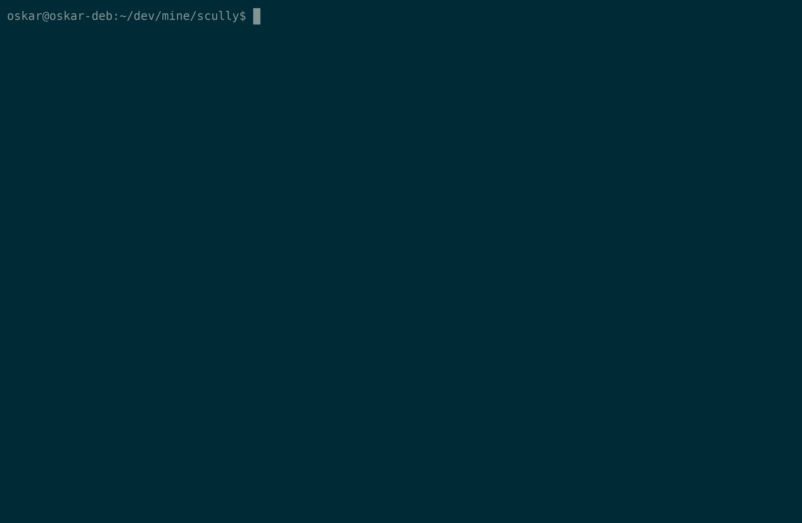

# scully

A Linux syscall tracer for x86-64, written in Rust and modeled on `strace`. It runs a program and prints every syscall it makes, with decoded arguments and return values.



## Install

Requires Linux x86-64 and the Rust toolchain.

```
cargo install --path .
```

To uninstall: `cargo uninstall scully`

Or build without installing:

```
cargo build --release
```

## Usage

```
scully [-c] <command> [args...]
```

With `-c`, only a statistics table is printed.

## Roadmap
- Decode more syscalls

## References
- [pawtrace](https://github.com/cocomelonc/pawtrace) and [ft_strace](https://github.com/Taiwing/ft_strace)
- [A Comprehensive Guide to System Call Tracing in Rust](https://jakobwaibel.com/writing/ptrace/) (Jakob Waibel)
- `ptrace(2)` and `syscall(2)` man pages
